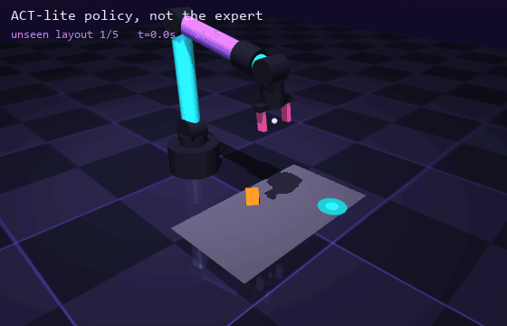
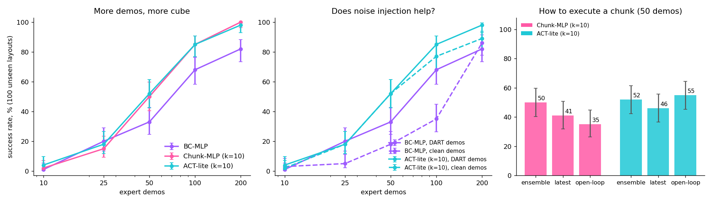

# COPYCAT

[](https://github.com/nonberw/copycat/actions/workflows/tests.yml)
[](LICENSE)
[](requirements.txt)
[](https://mujoco.org)

> Imitation learning for a robot arm, **from scratch**. A scripted expert shows a 6-DoF arm how to pick up a cube and put it on a pad, a neural network watches, and then the network does it alone on layouts it has never seen.
> No LeRobot, no robomimic, no pretrained anything. Just MuJoCo, PyTorch and a very patient expert.



*The learned ACT-lite policy (not the scripted expert) on the first 5 evaluation layouts, back to back, no cherry-picking: these are seeds 100000-100004, never seen in training. 5/5 placed. Played at 1.5x.*

---

## TL;DR

- **A pick-and-place task in MuJoCo** on the ARMageddon arm with a real two-finger gripper: random cube position and yaw, random target pad, contact physics, no teleporting.
- **A scripted expert** (state machine + ARMageddon IK on privileged state) that succeeds on 100/100 evaluation layouts, and on 98/100 with 0.02 rad of correlated noise shoved into every joint command.
- **DART noise injection** while recording demos, so the dataset contains recoveries, not just the happy path.
- **Three policies from scratch in PyTorch**: BC-MLP, Chunk-MLP, and ACT-lite (transformer + action chunks + temporal ensembling).
- **38 trained-and-evaluated configs, 100 unseen layouts each**, with 95% confidence intervals. Headline: with 200 demos, **ACT-lite places the cube 98% of the time, Chunk-MLP 100%, plain BC 82%**.
- **The honest twist**: the transformer is not the hero. Chunking is. An MLP that predicts 10 actions matches the transformer everywhere, and the transformer predicting 1 action is the worst thing in the repo (3%).
- **21 tests**, and every number in the results tables comes straight from [`results/results.json`](results/results.json).

## What even is this

Teaching a robot by writing code for every situation does not scale. Teaching it with reinforcement learning means letting it flail for a few million episodes. **Imitation learning** is the third option: show it how it's done, a few dozen times, and let a network copy the vibe.

The setup here is the classic one from modern robot learning papers, scaled down to fit on a laptop:

1. A **task**: pick a cube from a random spot (random yaw too) and place it on a randomly placed target pad. ARMageddon arm ([project 1](https://github.com/nonberw/armageddon)), parallel gripper, real contact physics.
2. An **expert** that cheats: it reads the true cube pose straight from the simulator and solves IK with ARMageddon. It's basically a teacher with the answer key.
3. **Demonstrations** recorded from the expert, with **DART noise** so the dataset also contains "oops, I drifted, here's how to get back".
4. **Policies** trained on those demos with plain supervised learning: a BC MLP, an MLP with action chunks, and a small ACT-style transformer with action chunks and temporal ensembling.
5. **Evaluation** on 100 unseen layouts per config, with confidence intervals, because "it worked when I tried it" is not a result.

## How it works (the math, no cap)

### The task, formally

Every tick (20 Hz) the policy sees a 20-dim observation

$$o_t = \big[\,q_t,\ \dot q_t,\ g_t,\ p^{cube}_t,\ \sin 4\psi_t,\ \cos 4\psi_t,\ p^{pad}\,\big]$$

joint angles, joint velocities, gripper half-gap, cube position, cube yaw, pad position. The yaw goes in as $\sin 4\psi, \cos 4\psi$ because a cube looks identical every 90 degrees, so the raw angle would make the network learn four copies of the same thing plus a discontinuity.

It outputs a 7-dim action $a_t = [\,q^{des}_t,\ w_t\,]$: absolute joint position targets for the six position servos and a gripper width command. Gravity is fed forward, so a target is a target, not a suggestion.

One trick that matters more than any architecture choice below: the network predicts the targets **relative to the current joints**, $q^{des}_{t+j} - q_t$, and adds $q_t$ back at execution. Across the dataset an absolute target spreads over ~0.3 rad, while one tick of motion is ~0.03 rad. A regression error of a few percent on the absolute value eats the whole step. Measured on Chunk-MLP with everything else fixed: 20% -> 58% success at 50 demos, 96% -> 100% at 200, just from this change (pilot runs, not in `results.json`).

Success = cube resting on the pad (center within 4.5 cm) and the gripper open. Max 10 s per episode.

### The expert

A finite state machine (`approach -> descend -> grasp -> lift -> carry -> lower -> release -> retreat`) on privileged state. The key detail: **it's a feedback controller, not a replayed trajectory**. Every tick it reads the measured joints, takes a bounded Cartesian step toward the current phase's goal

$$x^{cmd} = x_t + \mathrm{clip}\big(k\,(x^{goal} - x_t),\ v_{max}\Delta t\big)$$

(orientation gets the same treatment on SO(3) via the log map), and solves 6D IK from the current joints. Lost the cube mid-carry? Back to `approach`. Cube landed off the pad? Go get it again. That's what makes DART work: the teacher has to know how to recover from states it would never get into by itself.

### Behavior cloning

Given demos $\mathcal D = \{(o_t, a_t)\}$, BC is just regression:

$$\min_\theta\ \mathbb E_{(o,a)\sim\mathcal D}\ \big\| \pi_\theta(o) - a \big\|_1$$

The catch is **compounding error** (Ross et al., 2011). The policy is trained on the expert's state distribution, but at test time it visits its own. A small mistake puts it in a slightly unfamiliar state, where it makes a bigger mistake, and so on. With a per-step error rate $\epsilon$ over a horizon $T$, the expected cost can grow like $O(\epsilon T^2)$ instead of $O(\epsilon T)$. A quadratic is not the vibe.

### DART: noise in, clean labels out

DART (Laskey et al., 2017) fixes the distribution mismatch on the data side. While recording, the robot executes a perturbed action, but the dataset stores the clean one:

$$\tilde a_t = a^{expert}(s_t) + \varepsilon_t, \qquad \mathcal D \leftarrow \mathcal D \cup \{(o_t,\ a^{expert}(s_t))\}$$

So the robot actually drifts off the nominal path, and every drifted state comes labeled with "here's how the expert would correct". Here $\varepsilon_t$ is AR(1) noise on the joint targets,

$$\varepsilon_t = \rho\,\varepsilon_{t-1} + \sqrt{1-\rho^2}\,\sigma\,\xi_t,\quad \xi_t\sim\mathcal N(0, I),\ \rho = 0.8$$

because white noise at 20 Hz just gets low-passed away by the servos and teaches nothing. Each episode draws its own $\sigma \sim U(0, 0.02)$ rad, so the data covers both clean and sloppy runs. At $\sigma = 0.02$ the gripper ends up 1 to 1.5 cm off target, and the expert still succeeds on 98 of the 100 evaluation layouts (and on 200/200 while recording, where $\sigma$ is drawn per episode). At $\sigma = 0.03$ it drops to about 40%: the noise is now bigger than the grasp tolerance, so that's the ceiling.

### Action chunking (ACT-style)

Instead of one action, predict the next $k$:

$$\pi_\theta(o_t) = (\hat a_{t}, \hat a_{t+1}, \dots, \hat a_{t+k-1}), \qquad \mathcal L = \frac1k \sum_{j=0}^{k-1} \big\|\hat a_{t+j} - a_{t+j}\big\|_1$$

This is the main idea of ACT (Zhao et al., 2023). Predicting a chunk cuts the effective decision horizon by $k$, and it forces the network to commit to a coherent motion instead of re-deciding (and dithering) every tick.

**Temporal ensembling.** We still query every tick, so at time $t$ there are up to $k$ predictions for the current step, one from each recent chunk. Execute their weighted average:

$$a_t = \frac{\sum_{i=0}^{n-1} w_i\, \hat a_t^{(s_i)}}{\sum_{i=0}^{n-1} w_i}, \qquad w_i = e^{-m\,i}, \quad m = 0.1$$

where $\hat a_t^{(s)}$ is what the chunk predicted at tick $s$ says to do at tick $t$, and $s_0 < s_1 < \dots$ are the last $n \le k$ query ticks, so $i = 0$ is the oldest prediction, exactly like the ACT paper. This smooths the motion and lets new observations steer it without jerks.

**The model, "ACT-lite".** Observation split into 3 tokens (proprio, cube, pad), a 2-layer transformer encoder over them, then a 2-layer decoder with $k$ learned queries (one per future step) that cross-attend to the encoder. $d_{model} = 64$, ~240k parameters (a $d_{model} = 128$ version scored the same in a pilot run, 48% vs 53% at 50 demos, and took twice as long to train). What's missing vs. real ACT: the CVAE (our expert is deterministic, so there's no multimodality for it to model) and the ResNet image backbone (low-dim observations for now). "Chunk-MLP" is the control group: the same MLP as BC, just with a $k \times 7$ output head, to separate "chunking helps" from "transformers help".

### Training

L1 loss on standardized actions (separately per future step $j$ and per action dimension, since a target 10 ticks ahead moves much further than the next one), AdamW, linear warmup then cosine decay, batch 256, gradient clipping, dropout 0.1. **The same 20k gradient steps for every dataset size**, so small datasets don't lose just because they got fewer updates. All three policies use L1 so the comparison is about the architecture, not the loss.

Performance side quest: on a laptop RTX 3050 Ti under Windows the transformer step took ~28 ms, and a model 4x smaller was *exactly as slow*. Pure kernel-launch latency. Fixes: the whole train step (forward, backward, grad clipping, AdamW) is captured into a **CUDA graph** and replayed, attention is forced onto the plain-matmul SDPA backend (the fused kernels tile for 64+ tokens and we have 3 and 10), and TF32 is on. BC trains 20k steps in ~10 s, ACT-lite in ~2-3 min.

## Results

All numbers: success out of 100 rollouts on unseen layouts (seeds 100000-100099; demos use seeds below 60000), 95% Wilson interval in brackets. One training seed per cell unless stated. Measured, not vibes.



### Main table: success vs. number of demos

| policy | 10 demos | 25 demos | 50 demos | 100 demos | 200 demos |
|---|---|---|---|---|---|
| BC-MLP | 1% [0, 5] | 20% [13, 29] | 33% [25, 43] | 68% [58, 76] | 82% [73, 88] |
| Chunk-MLP (k=10) | 2% [1, 7] | 15% [9, 23] | 50% [40, 60] | 85% [77, 91] | **100%** [96, 100] |
| ACT-lite (k=10) | 4% [2, 10] | 18% [12, 27] | **52%** [42, 62] | 85% [77, 91] | 98% [93, 99] |
| *scripted expert* | | | | | *100%* |

Training seeds at 50 demos (seeds 0 / 1 / 2): BC-MLP 33 / 34 / 24, Chunk-MLP 50 / 49 / 48, ACT-lite 52 / 46 / 47. So the BC vs. chunking gap (~30% vs. ~48%) is real, while Chunk-MLP vs. ACT-lite is a coin flip.

### Does DART help?

The same policies trained on **clean** demos (no noise while recording), next to the DART ones:

| policy | 10 | 25 | 50 | 100 | 200 |
|---|---|---|---|---|---|
| BC-MLP, clean demos | 3% | 5% | 18% | 35% | 86% |
| BC-MLP, DART demos | 1% | 20% | 33% | 68% | 82% |
| ACT-lite, clean demos | 2% | 18% | 52% | 77% | 89% |
| ACT-lite, DART demos | 4% | 18% | 52% | 85% | 98% |

### Execution and chunk size (50 DART demos)

| | ensemble (default) | latest chunk, first action | open loop (replan every k) |
|---|---|---|---|
| Chunk-MLP | 50% | 41% | 35% |
| ACT-lite | 52% | 46% | 55% |

| ACT-lite chunk size k | 1 | 5 | 10 | 20 |
|---|---|---|---|---|
| success | 3% | 48% | 52% | 42% |

### The honest breakdown

**1. Chunking is the thing, not the transformer.** Going from 1 to 10 predicted actions is worth +17 to +19 points at 50 demos, +17 at 100 and +16 to +18 at 200. The transformer itself buys nothing over an MLP with the same chunked output: 50 vs. 52, 85 vs. 85, 100 vs. 98, all inside each other's error bars. And the transformer *without* chunks (k=1) collapses to 3%, way below the plain MLP's 33%. Small low-dim problem, small data: the MLP is just the better tool here, and I'm not going to pretend otherwise because transformers are cool.

**2. Why does plain BC plateau? Because it can't see the clock.** [`scripts/failure_modes.py`](scripts/failure_modes.py) sorts failed rollouts by what went wrong. At 200 demos **all 18 of BC's failures are the same thing: it closes the gripper on the cube and then just sits there, forever.** The expert pauses for 8 ticks (0.4 s) while the fingers close, then lifts. That pause is driven by a timer, and the timer isn't in the observation. Once the fingers have settled, "still waiting" and "time to lift" look identical, so a policy that maps one observation to one action learns "keep holding" and freezes in a fixed point. A chunked policy sees the lift coming 10 ticks ahead and sails through. This is exactly the failure the ACT paper uses to motivate chunking (pauses and non-Markovian behaviour in human demos), reproduced on a laptop. ACT-lite at 200 demos fails twice: once it never gets a grip, once it freezes at the same pause.

**3. At 50 demos, everyone's problem is precision.** For Chunk-MLP and ACT-lite about 40 of the ~50 failures are "never got a grip": the fingers arrive a centimetre off and the cube squirts out. That's not enough coverage of the workspace, and it's what more demos fix (85% at 100, 98-100% at 200). BC at 50 demos fails in every way possible, including dropping the cube off the pad (20 cases).

**4. DART helps a lot in the middle, not at the ends.** BC goes 18% -> 33% at 50 demos and 35% -> 68% at 100 with DART demos, ACT-lite 77% -> 85% at 100 and 89% -> 98% at 200. With 10 demos nothing works anyway, and BC at 200 is a draw (86% clean vs. 82% DART, well inside the noise). One caveat: DART demos are longer, since recoveries take time (48.9 vs. 39.0 ticks on average), so at equal demo count they also contain ~25% more samples. Part of the gain could be just more data. A sample-matched comparison is on the roadmap.

**5. Temporal ensembling is nice, not magic.** For Chunk-MLP it's the best way to execute (50% vs. 41% / 35%). For ACT-lite all three modes are within noise (46-55%). Either way, how you execute a chunk matters much less than having chunks at all.

**6. Chunk size has a sweet spot.** k=5 and k=10 are about the same; k=20 (1 s of motion) starts to hurt, since a longer chunk is a longer stretch of predicting the future without looking at it.

**Caveats, because I'm a scientist (lol).** One training seed per cell outside the seed study, so 5 points between neighbouring cells means nothing. Training uses CUDA graphs and TF32, which are not bitwise deterministic, so retraining a cell can land a few points away; the 3-seed spread at 50 demos is the realistic error bar. `failure_modes.py` re-runs the rollouts in a different process, so its success counts can differ by 1 from the table (CPU float math depends on the thread count, and contact physics amplifies the difference).

## How to run

```bash
pip install -r requirements.txt   # installs ARMageddon from GitHub too
```

```bash
python -m pytest
```

```bash
python scripts/collect.py --n 200 --noise 0.02 --out data/demos_dart.npz
```

```bash
python scripts/collect.py --n 200 --noise 0.0 --seed0 50000 --out data/demos_clean.npz
```

```bash
python scripts/run_experiments.py
```

```bash
python scripts/plot_results.py
```

```bash
python scripts/render_gif.py --ckpt checkpoints/act_dart_200_s0.pt
```

The ACT-lite checkpoint behind the GIF is committed, so `render_gif.py` works right after cloning, no training needed. `run_experiments.py` is resumable: it appends to `results/results.json` and skips configs that are already there. Delete the file to start over. A CUDA GPU is used for training if available; evaluation runs on CPU.

## Project layout

```
copycat/
  env.py        # MuJoCo scene (built with armageddon.mjcf), reset/step, observation, success check
  expert.py     # scripted expert: state machine + ARMageddon IK, recovers from perturbations
  data.py       # DART collection (multiprocessing), .npz storage, chunk targets
  policies.py   # BC-MLP, Chunk-MLP, ACT-lite transformer, temporal ensembling executor
  train.py      # L1 regression training loop, checkpoint save/load
  evaluate.py   # batched lockstep rollouts, Wilson confidence intervals
scripts/
  collect.py          # expert demos -> data/*.npz
  run_experiments.py  # trains + evaluates all 38 configs, resumable
  plot_results.py     # assets/results.png + the tables above
  failure_modes.py    # sorts failed rollouts by what went wrong
  render_gif.py       # assets/demo.gif from a checkpoint
tests/          # env determinism, expert success, dataset shapes, policies, training smoke test
results/        # results.json (every config), failure_modes.json
checkpoints/    # only act_dart_200_s0.pt (the GIF policy, ~1 MB) is committed
assets/         # demo.gif, results.png
```

## Roadmap

This is project 3 of a from-scratch physical-AI series:

1. **[ARMageddon](https://github.com/nonberw/armageddon)**: inverse kinematics for a 6-DoF arm, pure NumPy. The arm and the IK used here.
2. **[YOINK](https://github.com/nonberw/yoink)**: vision-based cube sorting with an RGB-D camera and a classical perception pipeline.
3. **COPYCAT** (you are here): imitation learning, BC vs. action chunking, DART.

Next for this repo:

- [ ] **Pixels instead of privileged state**: a small CNN encoder on a MuJoCo camera, so the policy finds the cube itself.
- [ ] **Full yaw range**: right now the cube spawns within 40 degrees of facing the robot so the expert's grasp choice is unimodal. Full rotation makes the expert's choice jump between equivalent grasps, which is exactly the multimodality the ACT CVAE (or a diffusion policy) is for.
- [ ] **DAgger** as an upper bound for DART: query the expert on the learner's own states.
- [ ] **Sample-matched DART ablation**: compare at equal numbers of samples, not just equal numbers of demos.
- [ ] **Diffusion Policy** as a third contender.
- [ ] Multi-cube tasks, so the policy has to plan an order.

## FAQ

**Why not just use LeRobot / robomimic?**
Because then I'd learn how to call `train.py`. The point of this series is to build each piece myself and understand why it works (or doesn't). The whole library is about 700 lines.

**Is this "real" ACT?**
It's ACT-lite. Same core ideas (action chunks, learned queries in a transformer decoder, temporal ensembling with exponential weights), minus the CVAE and the ResNet camera backbone. The expert is deterministic and the observations are low-dim, so neither would earn its keep here. And as the results show, on this task even the transformer part is optional.

**The expert cheats with the true cube pose. Isn't that unfair?**
That's the standard setup: the expert is allowed privileged information, the policy learns from its demos. Here the policy also gets the cube pose, so it's "low-dim imitation". The pixels version, where the policy has to find the cube in a camera image, is next on the roadmap.

**Why are actions joint targets and not end-effector poses?**
It's what ACT does on real robots, and it means the policy has to learn IK implicitly, which is more interesting than learning where to put the hand. The relative parameterization (predict $q^{des} - q$) is what makes that learnable.

**Why does the cube only spawn within 40 degrees of facing the robot?**
A cube is symmetric every 90 degrees, so there are always several equally good grasps. If the expert's choice between them flips across the workspace, the demos become multimodal and any L1/L2 regressor averages two grasps into a garbage one in between. Restricting the yaw keeps the expert's choice unique, so the comparison is about compounding error, not multimodality. Multimodal grasps are the next experiment (that's what the CVAE in ACT, or diffusion policies, are for).

**Can it run without a GPU?**
Yes. Everything works on CPU. Training ACT-lite on CPU is slow, the MLPs are fine. Evaluation always runs on CPU.

**Why the name?**
Because it copies whatever it sees, it's small, and it occasionally knocks things off the table.

## License

MIT, see [LICENSE](LICENSE).
